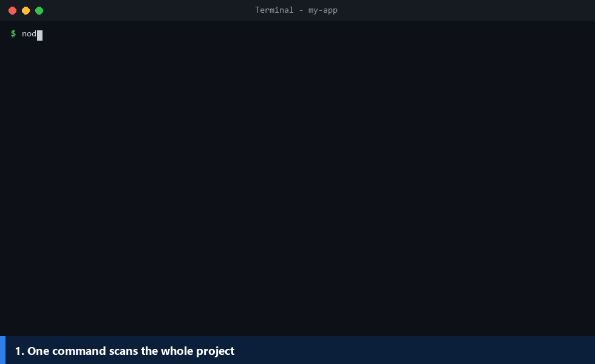

# Muhammad Talha

Full-stack .NET developer. I build CMS-driven websites (Umbraco, Sitecore, Kentico) and secure web applications.

### About

I work across the whole stack: ASP.NET Core MVC and Web Forms on the server, SQL Server for data, Angular and JavaScript in the browser, and Azure DevOps for build and release. Most of my work is content-managed websites, where clean structure and safe releases matter as much as features. That is also why I built Security Gate.

### Featured project: Security Gate

**One command that checks a project for security problems before every release.**

- Runs seven open-source scanners in Docker: gitleaks, Semgrep, OSV-Scanner, NuGet Audit, Trivy, Grype and OWASP ZAP
- Gives a clear PASS or FAIL, a security grade from A to E, and a PDF report mapped to the OWASP Top 10:2025
- Can start your web app, test it with OWASP ZAP, and stop it again
- Works on its own or as a skill inside AI coding tools (Claude Code, Cursor, Codex)

[View the repository](https://github.com/mtalhaamin/Security-Gate-Skill) | [Latest release](https://github.com/mtalhaamin/Security-Gate-Skill/releases/latest)

### Tech stack

- **Backend:** C#, .NET, ASP.NET Core MVC, ASP.NET Web Forms
- **CMS:** Umbraco, Sitecore, Kentico
- **Frontend:** Angular, JavaScript, HTML, CSS
- **Database:** SQL Server
- **Mobile:** Android
- **Cloud and DevOps:** Azure, Azure DevOps, IIS, Docker, GitHub Actions

### Currently working on

- Improving Security Gate and testing it on more kinds of projects (Node, Python, Java)
- Building .NET and Umbraco websites

### Contact

